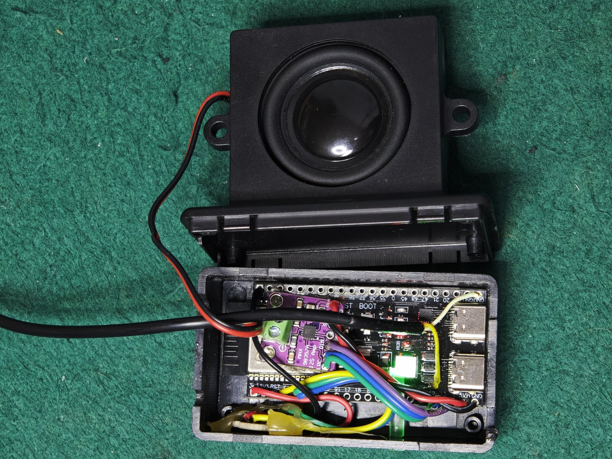
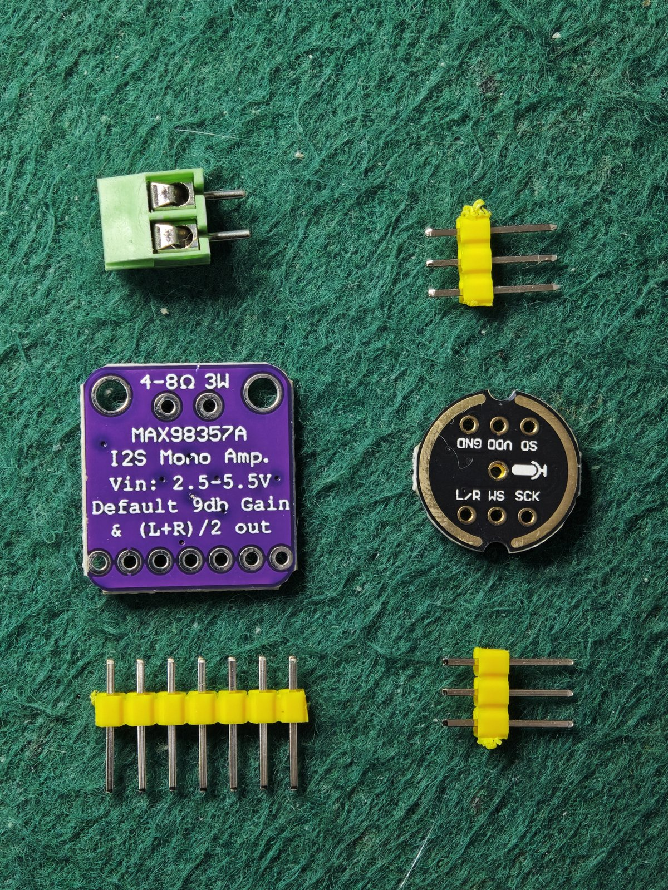
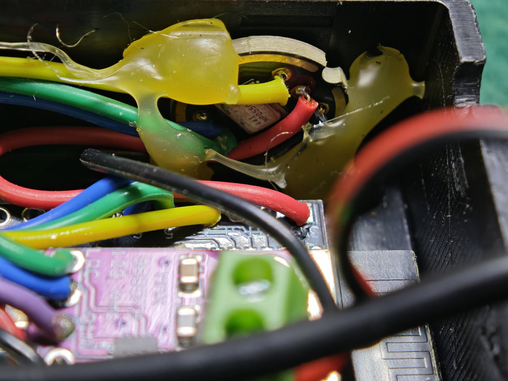
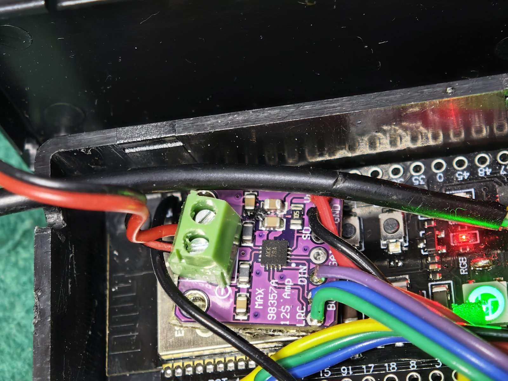
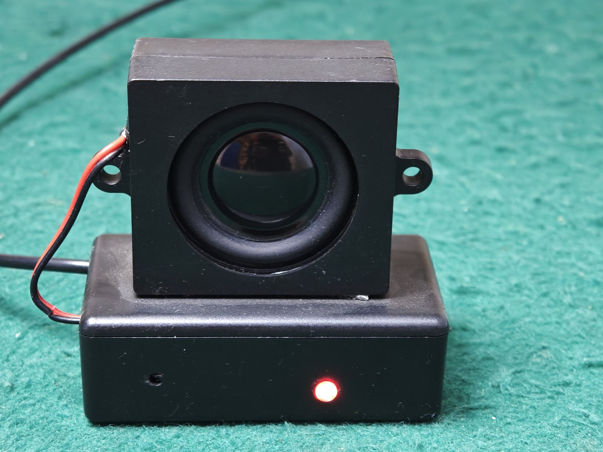

# ESP32-S3 Voice Assistant & Media Player (N16R8)

**This project is a Voice Assistant and a Media Player for
[Home Assistant](https://www.home-assistant.io/)**: a DIY smart speaker that acts
as a voice-assistant satellite (wake word, conversations, timers) and at the same
time as a streaming media player (internet radio, MP3 streams, HA media), built
from a cheap ESP32-S3 devkit and two I2S modules. Say
**"okay nabu"**, ask things, play internet radio or any MP3 stream from HA — and follow the whole
conversation through a status LED light pipe.


This repository contains the complete ESPHome firmware configuration (YAML), the embedded sounds,
build photos and the hard-earned notes of a device that runs in production every day.

## Features

- **On-device wake word** (`okay_nabu` via [microWakeWord](https://github.com/kwf246/microWakeWord)),
  no cloud needed for detection; STT/TTS run in your Home Assistant voice pipeline.
- **Media player** (`media_player` entity): MP3 streams, internet radio, TTS broadcasts — mixed
  with the assistant through a 2-source **I2S mixer**.
- **Music ducking**: while the assistant listens or answers, music drops 20 dB instead of stopping,
  then restores automatically.
- **Follow-up conversations**: consecutive questions without repeating the wake word (when the HA
  agent sets `continue_conversation`).
- **Voice timers**: when a timer finishes the device beeps 5 times with a synchronized **yellow LED
  flash**.
- **Full LED status palette** behind a light pipe, with a master on/off switch and automatic
  reconciliation with the real state (mute, listening, thinking…).
- **Mute switch** in HA: stops wake word and assistant, LED turns solid red.
- **OTA updates** through the ESPHome dashboard, API and OTA both encrypted.
- **Fallback AP + captive portal** if WiFi is unavailable.
- No buttons required (a push-to-talk variant is easy to add — the GPIOs are free).

## Hardware

To build this project you need exactly these parts:

1. **ESP32-S3 N16R8** development board (the one with on-board WS2812 on GPIO48)
2. **INMP441** I2S MEMS microphone module
3. **MAX98357A** I2S amplifier module
4. **4 Ω speaker** (3–5 W)

plus a 5 V USB-C power supply, a project box and (optional) the acrylic light
pipe. Full details:

| Part | Role | Notes |
|---|---|---|
| ESP32-S3 **N16R8** devkit | Main board | 16 MB flash / 8 MB octal PSRAM. The R8 (octal) PSRAM matters: the wake word + audio buffers need it. |
| **INMP441** module | I2S MEMS microphone | 3-wire + GND/VCC. |
| **MAX98357A** I2S amplifier | Drives the speaker | Set GAIN floating/1N for ~9 dB. |
| 4 Ω 3–5 W speaker (≈50 mm) | Output | The one in the photos is a small square-framed driver. |
| WS2812 / NeoPixel LED | Status light | On-board on many S3 devkits at **GPIO48**. |
| USB-C 5 V supply | Power | ≥1 A recommended (WiFi bursts + speaker peaks). |
| Project box + 3 mm acrylic rod | Enclosure | The rod is a light pipe for the LED (see below). |

## Wiring

| Signal | ESP32-S3 GPIO | Device pin |
|---|---|---|
| Mic WS (LRCLK) | GPIO5 | INMP441 `WS` |
| Mic SCK (BCLK) | GPIO6 | INMP441 `SCK` |
| Mic SD (data) | GPIO4 | INMP441 `SD` (L channel) |
| Amp LRC | GPIO12 | MAX98357A `LRC` |
| Amp BCLK | GPIO13 | MAX98357A `BCLK` |
| Amp DIN | GPIO14 | MAX98357A `DIN` |
| Status LED | GPIO48 | WS2812 `DIN` |
| Power | 5V / GND | INMP441 `VCC`, MAX98357A `Vin` |

> The INMP441 must transmit on its **left** channel (`L/R` pin to GND) — the firmware reads
> `channel: left`.

| The two I2S modules | Inside the box |
|---|---|
|  |  |
|  |  |
|  | |

## The enclosure and the light pipe

Any small ABS box works. The front-facing speaker sits on the lid; the WS2812 is glued behind a
**3 mm acrylic rod ≈ 31 mm long** that channels the status light to a small hole on the front —
cheap, invisible, and the LED colors read surprisingly well:

| Light pipe installed | Light pipe size |
|---|---|
|  |  |

## LED status palette

| Color | Meaning |
|---|---|
| 🟠 Orange pulse | Booting / no Home Assistant connection |
| 🟢 Green solid (40 %) | Ready — listening for the wake word |
| 🔵 Blue pulse | Listening (after wake word and during follow-up) |
| 🟣 Purple solid | Thinking / answering |
| 🔴 Red solid | Muted |
| 🟡 Yellow flash | Timer finished (synced with the 5 beeps) |

| Ready | Thinking | Muted |
|---|---|---|
|  |  |  |

The `on board light` entity in HA acts as a **master switch**: turning it off silences the LED
entirely; turning it back on repaints the *real* current state (e.g. red if muted).

## Firmware setup

Requirements: [ESPHome](https://esphome.io/) **2026.10.2 or newer** (tested with the ESPHome
HA add-on; standalone `pip install esphome` works too).

1. Copy the three files from [`esphome/`](esphome/) into your ESPHome config folder:
   - `voice-assistant-s3-n16r8.yaml`
   - `aviso.h` (wake chime, embedded in flash — zero RAM cost)
   - `sounds_timer_finished.wav` (timer beep)
2. Copy `secrets.yaml.example` to `secrets.yaml` (same folder) and fill in your WiFi SSID/password,
   an API encryption key and an OTA password. Generate the key with:
   ```bash
   python3 -c "import base64,os; print(base64.b64encode(os.urandom(32)).decode())"
   ```
3. Install the external component used for the embedded beep — ESPHome fetches it automatically on
   first compile (`jesserockz/esphome-components`).
4. **First flash over USB**: put the board in bootloader mode (hold `BOOT`, tap `RESET`) and use
   `esphome upload voice-assistant-s3-n16r8.yaml --device /dev/ttyACM0` or the dashboard's
   "Plug into this computer" option. Some S3 boards need a USB-C **data** cable — many false
   "port not detected" problems are just charge-only cables.
5. Later updates go **OTA** (the device appears in the ESPHome dashboard once HA adds it).

Notes:
- `psram.mode: octal` is for **N16R8** modules. If your board is N8R2, use `mode: quad` and expect
  much less headroom.
- The framework is `esp-idf` (not arduino): the modern audio pipeline requires it.
- WiFi uses DHCP by default. For a fixed address, add a `manual_ip:` block under `wifi:`.

## Home Assistant side

1. **Settings → Devices & Services → ESPHome**: import/add the node (it offers itself once on the
   network). The device exposes:
   - `assist_satellite` (the voice assistant itself)
   - `media_player` ("Media Player") — send any MP3/radio URL or HA media to it
   - `light` ("on board light") — LED master switch
   - `switch` ("mute") — mute wake word + assistant
   - `button` ("Restart")
2. **Settings → Voice assistants**: create/keep a pipeline with any STT + TTS you like (the wake
   word runs on the device, so HA needs no wake-word component). A Spanish/English pipeline with
   Whisper or cloud STT and Piper/cloud TTS both work.
3. In the Assist satellite settings for this device, an **aggressive VAD** works well: the mic is
   sensitive and the room is normally quiet.
4. To use timers, just ask: *"set a timer for 10 minutes"* — the device beeps and flashes yellow
   when it finishes (handled entirely in the firmware, `on_timer_finished`).

### Playing music

From HA, send media to the `media_player` entity, e.g. an internet radio station:

```yaml
service: media_player.play_media
target:
  entity_id: media_player.voice_assistant_s3_n16r8_media_player
data:
  media_content_id: "https://example.com/stream.mp3"
  media_content_type: music
```

The assistant automatically ducks the music while answering and restores it afterwards.

## Customizing the sounds

- `tools/generate_sounds.py` regenerates **both** embedded sounds (wake chime + timer beep) with
  plain Python — no ffmpeg. Edit the frequencies/durations and recompile; the chime must stay
  under the 900 ms speaker ring (`buffer_duration`).
- To use your own audio: convert any clip to **16 kHz mono 16-bit PCM WAV**, then adapt the script.

## Known pitfalls (learned the hard way)

These are the failure modes that took real debugging, captured in the YAML comments too:

1. **`on_end` fires at the START of the answer**, not at the end. The "ready" green LED belongs in
   `on_tts_stream_end`; putting it in `on_end` makes the light jump to green while the device is
   still speaking.
2. **Music left PAUSED jams the mixer** and the next assistant answer is mute. The firmware stops
   a paused media source on wake-word detection, before the chime.
3. **The speaker output ring is `buffer_duration`**: with 500 ms the 0.8 s wake chime was truncated.
   Both the physical speaker and the announcement source need ≥900 ms.
4. **`light.turn_off` must never be used to blank the LED** during the timer flash: it would fire
   the light's `on_turn_off` and tear down the LED master switch. Black = `brightness: 0%` with the
   color channels fixed (painting RGB 0/0/0 made HA interleave white frames).
5. **The core's default light transition is 1 s**: without `default_transition_length: 0s` the first
   timer flash fades in from resting green (looks green, not yellow). A per-action
   `transition_length` cannot be combined with `effect: none` (exclusive option group).
6. **Follow-up listening only happens if the HA agent sets `continue_conversation`** — the blue
   pulse logic in `on_listening` covers it, but don't blame the firmware when the pipeline closes
   the session.
7. **Partial `light.turn_on` calls inherit** previous channels/effects: always set full RGB +
   explicit `effect`.

## Limitations

- **No acoustic echo cancellation**: this hardware has no reference-signal path, so the mic can
  hear the speaker. Ducking + the wake-word gate are the practical mitigation; avoid talking to it
  at maximum volume over loud music.
- Wake-word false positives can appear with loud/noisy environments; tune `probability_cutoff`
  (0.97 by default).
- Native `assist_satellite.announce` (pre-announcement chimes from HA) is unreliable on a satellite
  that owns a speaker in this ESPHome version — announcements are handled through the internal
  announcement mixer source instead.

## Repo layout

```
esphome/   firmware YAML + embedded sounds + secrets example
docs/photos/  build photos
tools/     generate_sounds.py (regenerate the embedded audio)
```

## License / credits

MIT — see [LICENSE](LICENSE). Firmware, photos and documentation by **Javier Mur** (production
device, November 2026). Built on ESPHome, microWakeWord and the Home Assistant voice assistant
ecosystem. Contributions and issue reports welcome.
